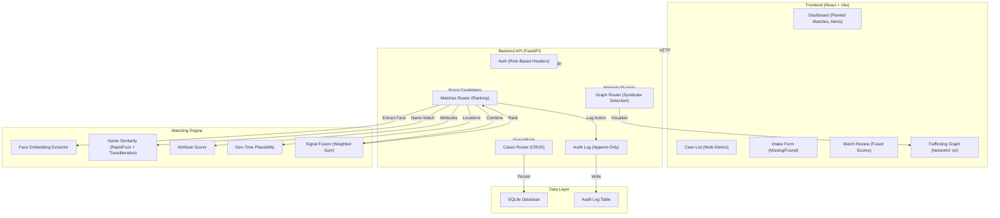

# Rakshak Link 🛡️

**Cross-District Missing Person & Anti-Trafficking Intelligence Portal**

Rakshak Link is an AI-powered intelligence portal built for Police Station Officers, Child Welfare Committees (CWC), and Investigating Officers (IO) to match missing person reports with found/rescued individuals across districts and detect interstate trafficking networks.

---

## Key Features

1. **Multi-Signal Matching Engine (`backend/app/services/matching.py`)**:
   - **Biometric Cosine Similarity**: Compares 128-dimensional face vector embeddings.
   - **Fuzzy & Phonetic Name Similarity**: Integrates RapidFuzz ratio/token algorithms, Jellyfish Metaphone, and Devanagari to Latin phonetic transliteration (`backend/app/services/transliteration.py`).
   - **Attribute Overlap**: Composite scoring across age difference, sex match, height variance, physical marks, and clothing description tokens.
   - **Geo-Time Plausibility**: Computes required travel speed between last-seen/found locations and times using Haversine distance.

2. **Privacy-Preserving Cross-District Data Sharing**:
   - Biometric vector embeddings and anonymized feature signatures cross district borders for automated scoring.
   - Raw photograph URLs are restricted to the originating district until a match link is officially verified by an Investigating Officer.

3. **Trafficking Syndicate Network Graph (`backend/app/services/graph_service.py`)**:
   - Graph visualization powered by Cytoscape.js & NetworkX mapping case nodes, phone numbers, and location hubs.
   - Automated detection of syndicates flagging clusters with 3+ cases sharing phone numbers or key transport hubs.

4. **District-Scoped Access & Audit Logging**:
   - Role-based authorization headers (`Station Officer`, `CWC Officer`, `Investigating Officer`).
   - Scoped database views and append-only audit log trace of all views, matches, and decisions.

---

## Technology Stack

- **Backend**: FastAPI, SQLite (SQLAlchemy 2.0), Pydantic v2
- **Data & Intelligence**: NumPy, RapidFuzz, Jellyfish, NetworkX
- **Frontend**: React 18, Vite, Tailwind CSS, Lucide Icons, Cytoscape.js
- **Testing**: pytest

---

## Quick Start & Installation

```bash
# 1. Install all backend (Python) and frontend (npm) dependencies
make install

# 2. Seed database (~200 synthetic records, 4 districts, 15 planted cross-district matches, 2 trafficking clusters)
make seed

# 3. Run application (Backend API on :8000 & Frontend Vite on :3000)
make run
```

### Running Test Suite
```bash
make test
```
*pytest asserts that 100% of planted cross-district test cases rank in top-5 candidate matches.*

---

## 🎬 2-Minute Demo Script

1. **Seed & Start**: `make seed && make run` (Backend on :8000, Frontend on :3000)
2. **Open**: http://localhost:3000
3. **Missing Report**: As "Pune Station Officer", file missing case: Ramesh, Age 14, Mole on cheek, Shivajinagar, Phone +919820012345
4. **Found Match Alert**: Switch to "Thane Investigating Officer"; see ranked match from Thane (Ramesh found at Railway Shelter)
5. **Verify & Alert**: Click "Verify & Alert Districts"; both cases move to MATCHED status
6. **Trafficking Network**: Click "Graph View"; observe **SYNDICATE CLUSTER** (phone +919820012345 linking 4 cases across 3 districts)
7. **Audit Trail**: Click "Audit Log"; inspect all actions (Case filed, Match scored, Alert sent, etc.)

---

## Face Matching

Rakshak Link supports pluggable face embedding backends for biometric matching.

### Embedding Backend Configuration

Set the `EMBEDDING_BACKEND` environment variable to choose the extraction strategy:

```bash
# Use real InsightFace embeddings (512-dimensional, L2-normalized)
export EMBEDDING_BACKEND=insightface

# Use synthetic deterministic embeddings (default for demo reproducibility)
export EMBEDDING_BACKEND=synthetic  # or unset
```

**Default**: `synthetic` (no model download required; ensures demo stability)

### InsightFace Backend

When `EMBEDDING_BACKEND=insightface`:
- **Model**: InsightFace buffalo_s (512-d L2-normalized embeddings)
- **Face Detection**: RetinaFace with det_size=(320,320)
- **Lazy Loading**: Model downloaded on first inference (~125MB)
- **License**: Non-commercial research use only

### Evaluation Results (LFW Dataset)

See [`docs/face_eval.md`](docs/face_eval.md) for detailed evaluation metrics on LFW face pairs:

| Metric | Value | Std Dev |
|--------|-------|---------|
| Mean same-person cosine similarity | 0.5295 | ±0.1134 |
| Mean different-person cosine similarity | 0.0179 | ±0.0742 |
| Threshold for ~1% FAR | 0.1920 | — |

**Signal Ablation on Planted Matches** (see [`docs/ablation.md`](docs/ablation.md)):
- Face-only: 100% @ Rank-1, 100% @ Rank-5
- Name-only: 100% @ Rank-1, 100% @ Rank-5
- All signals fused: 100% @ Rank-1, 100% @ Rank-5

(Note: Planted pairs share same person, phone numbers, and similar attributes.)

**Hard Ablation on Corrupted LFW** (see [`docs/hard_ablation.md`](docs/hard_ablation.md)):
- Face-only: 31.7% @ Rank-1, 100.0% @ Rank-5 (degraded to 40px + blur)
- Fused: 91.7% @ Rank-1, 100.0% @ Rank-5 (name corruption, photo degradation, metadata jitter)

(Synthetic corruption: 30% name misspell/missing, 30% photo downscale+blur, 30% age±5yr, location/time jitter; gallery=180 distractors; fused signal recovers where face-only fails)

### Interpretation

- **Commercial Use**: InsightFace pretrained models are for non-commercial research use only.
- **Dataset Bias**: LFW is predominantly adult, good-quality frontal/near-frontal faces from unconstrained photographs.
- **Coverage**: No validation on CCTV footage, low-quality images, or varied poses.
- **Children**: LFW is underrepresented in child faces; model performance on minors is not validated.
- **Accuracy Claims**: This implementation makes no claim on accuracy guarantees, completeness, or suitability for any specific application. It is a research prototype for demonstration purposes only.

---

## Architecture



---

## Limitations & Research Prototype Status

Rakshak Link is a **research prototype for demonstration purposes only**. Do not deploy in production or rely on it for case decisions without expert review.

### Data & Evaluation
- **Embedding Validation**: Trained on LFW (adult, frontal, high-quality). No validation on CCTV, low-quality, varied-pose, or child faces.
- **Hard Ablation**: Tested on synthetic corruption of LFW (30% name misspelling, 30% photo blur+downscale, 30% age jitter). Not real case data; does not reflect true missing person demographics or real-world degradation patterns.
- **Planted Matches**: The 15 test cases in seeded database are synthetic cross-district pairs designed to validate the algorithm, not real cases.

### Architecture & Security
- **Authentication**: Current demo uses role-based headers only. **Production must implement JWT or OAuth2 with secure session management.**
- **Audit Log**: Append-only table with sequential writes; no cryptographic hash chain. Vulnerable to direct database tampering.
- **Database**: SQLite with no encryption at rest. **Production must use PostgreSQL with TLS and encrypted backups.**
- **Photo Access**: Raw photo URLs are gated by district scope; no end-to-end encryption on the wire.

### Model & Weights
- **Face Embedding Model**: InsightFace buffalo_s (512-d, L2-normalized). Licensed for non-commercial research use only.
- **Signal Fusion Weights**: Manually tuned (face 0.35, name 0.25, attributes 0.20, geo-time 0.20). Not optimized on real case data; may require retuning for production domains.
- **No Guarantees**: This system makes no claim on accuracy, completeness, or fairness. False negatives and false positives are expected.

### Known Gaps
1. No CCTV frame validation or image quality assessment.
2. No temporal reasoning beyond simple travel-speed feasibility.
3. No feedback loop or active learning on verified matches.
4. No privacy-preserving techniques (differential privacy, federated learning).
5. No handling of intentionally altered features (cosmetic surgery, hair/tattoo changes).

---

## Limitations & Production Roadmap

1. **Embedding Extractor Interface**: The default extractor (`SyntheticEmbeddingExtractor`) uses deterministic feature hashing to generate 128-dimensional vector embeddings for demo reproducibility. In production, replace `SyntheticEmbeddingExtractor` in `backend/app/services/matching.py` with a deep learning vision pipeline (e.g., InsightFace / ArcFace ResNet50 model).
2. **Database Engine**: Current storage uses SQLite for zero-dependency execution; production deployment should utilize PostgreSQL with `pgvector` for indexing high-dimensional biometrics at scale.
